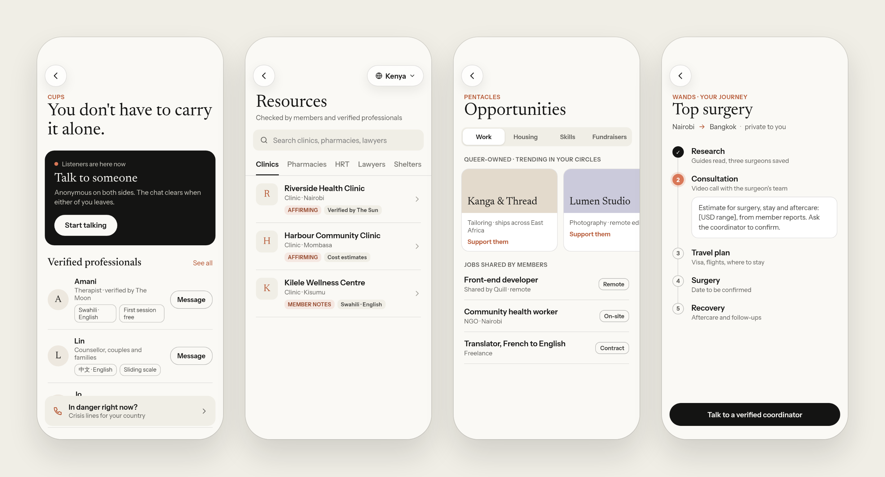
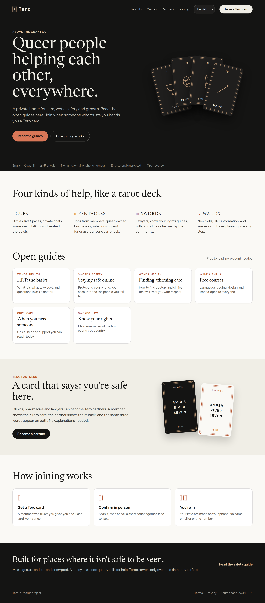
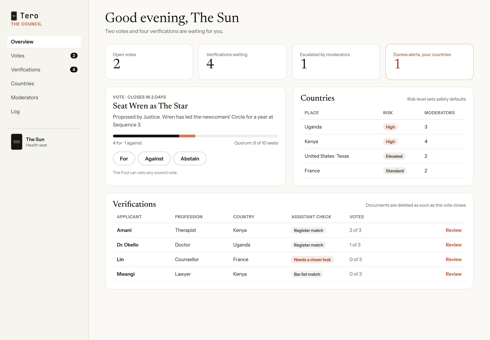

# Tero

**Queer people helping each other, everywhere.**

A private, invite-only home where queer people find each other, get real help from people they can trust, and lift each other up.

  

---

## Why Tero exists

In too many places it still isn't safe to be queer. Finding a doctor who won't judge you, a lawyer who will stand with you, a job, a room for the night, or just someone to talk to at 2am can be hard, lonely and sometimes dangerous.

Tero brings all of that into one calm, safe place, built by and for the community.

## What you'll find inside

Tero is organised like a tarot deck. Each of the four suits holds a different kind of help.

| | Suit | What's there |
|---|---|---|
| 🍷 | **Cups** · care | Circles and live audio Spaces, private chats, anonymous "someone to talk to", verified therapists and counsellors |
| 🪙 | **Pentacles** · livelihood | Jobs shared by members, queer-owned businesses to support, safe housing, fundraisers anyone can verify |
| ⚔️ | **Swords** · safety | Lawyers, know-your-rights guides, wills the community helps uphold, clinics and pharmacies checked by members |
| 🪄 | **Wands** · journeys | Learning new skills, HRT information, surgery and travel planning, members travelling who can help |

  

## Safe by design

Tero is built for people whose safety depends on staying unseen.

- **No name, email or phone number.** Your account is a set of keys that lives on your phone.
- **End-to-end encrypted.** Our servers only ever hold data they can't read.
- **Invite only.** You join when someone who trusts you hands you a single-use Tero card.
- **A passcode every time.** A second "decoy" passcode opens a harmless view and quietly alerts the people who brought you in.
- **Chats that fade.** Private chats clear by default unless both people choose to keep them.
- **Tero partners.** Clinics, pharmacies and lawyers who know Tero show the same three words as your Tero card, so you know you're safe before you say a thing.
- **Run by the community.** A council of trusted members, each holding a tarot card, verifies professionals and votes on decisions together.

## Open to everyone, in part

Anyone can visit **tero.pherus.org** to read open guides on health, safety and skills, in English, Kiswahili, 中文 and Français, with no account needed. The community itself stays behind a Tero card.

  

## Run together

The council looks after verifications, countries and big decisions. Moderators keep Circles and Spaces kind. Neither can read anyone's private messages.

  

## Where we are

Tero is in **design**. The ideas, safety model and screens are taking shape. Nothing is built yet, and nobody can sign up today.

- [See the clickable mockups](https://claude.ai/artifact/TpPoDJbAyYFAFGKgxdzqYd) (private for now)
- [Read how it all works](docs/README.md)

## Help build it

We're not taking contributions just yet, but when we open the doors we'll be looking for:

- **Translators**, so everyone can use Tero in their own language
- **Designers and developers** who care about privacy
- **Doctors, therapists and lawyers** willing to be verified and help members
- **Moderators** who know their country and community
- **Anyone** with ideas, stories or a place Tero should reach next

If that's you, watch this space. Contributors will be asked to agree to our [contributor agreement](CLA.md).

## A note on the name

Tero takes its name, and its tarot cards, from the Tarot Club in the novel *Lord of the Mysteries*: strangers who meet above the gray fog, each known only by their card, and help each other through a dangerous world.

---

Tero is a [Pherus](https://pherus.org) project · open source under [AGPL-3.0](LICENSE)

