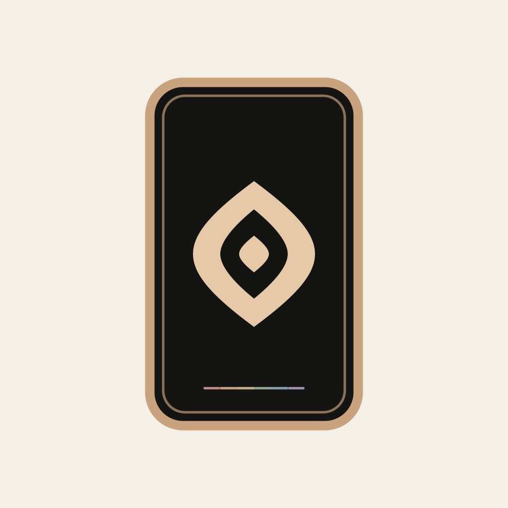
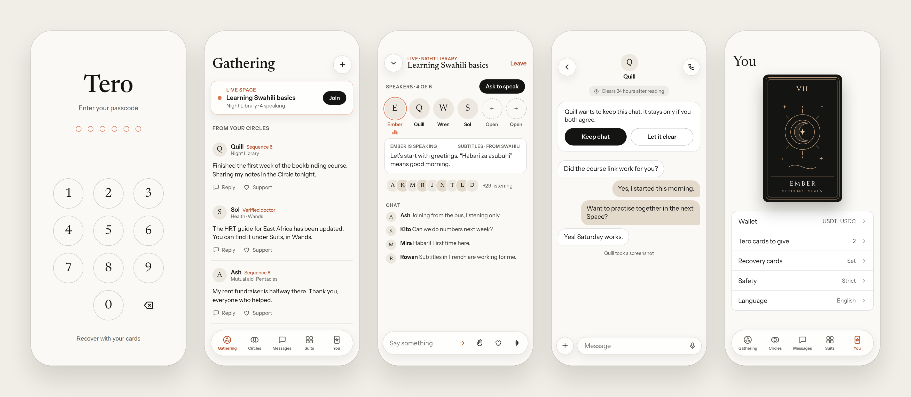

<div align="center">



# Tero

**A place to belong.**

A private, community-led space for LGBTQIA+ people to connect, find practical
support and share what helps, especially where being visible carries risk.

[Vision](docs/vision.md) · [Progress](https://github.com/phe-rus/tero/issues/10) · [Safety](docs/threat-model.md) · [Support](SUPPORT.md)

</div>

## Why Tero

Finding a trusted person, a safe place, relevant healthcare or useful advice
shouldn't be harder because of who you are. Tero brings trusted introductions,
community knowledge and mutual help into one considered experience.

The app is organised around **Gathering, Circles, Messages, Help and You**. Its
tarot-inspired identity remains intact across the web and native apps.

<p align="center"></p>

<p align="center"><sub>Early UI/UX concept artwork. Some features pictured are still planned.</sub></p>

## In development

Tero is **not ready for use in high-risk situations**. Invitation flows,
resources, local vaults and encrypted one-to-one chat have been demonstrated
in the legacy test app, but the new app and peer network are still in progress.

Not everything is end-to-end encrypted. Some service metadata and Help
submissions are readable by the server. See the [security audit](docs/status-audit-2026-10-20.md)
before deciding what to share.

<details>
<summary><strong>Why Expo → Tauri?</strong></summary>

One Tauri v2 app gives us a shared TypeScript interface and Rust-native identity,
storage and cryptography. We are retaining Expo for compatibility checks until
the replacement reaches parity.

</details>

## Be part of it

We're looking for contributors, local resource reviewers, designers, security
researchers and partners who care about accessible, safer queer infrastructure.
Support can help fund independent audits, localisation, mobile releases and
community stewardship. We have not yet measured public impact.

**[Support Tero](SUPPORT.md)** · **[Get in touch](mailto:pherus@pherus.org)**

See [project stages and open work](https://github.com/phe-rus/tero/issues/10) or
[propose an improvement](../../issues/new/choose).

<details>
<summary><strong>Development</strong></summary>

Built with Bun, Turborepo, TanStack, PassUI, Tauri v2 and Rust, alongside one
Cloudflare Worker. See [migration](docs/development/migration.md),
[conventions](docs/development/conventions.md) and [handoff](docs/continuation.md).

```bash
bun install --frozen-lockfile
bun run build:web
bun run --cwd apps/tero typecheck
bun run --cwd apps/tero test
```

</details>

<div align="center">

Built by **Tiabah La niina** at [Pherus](https://pherus.org) · [AGPL-3.0](LICENSE)

</div>
