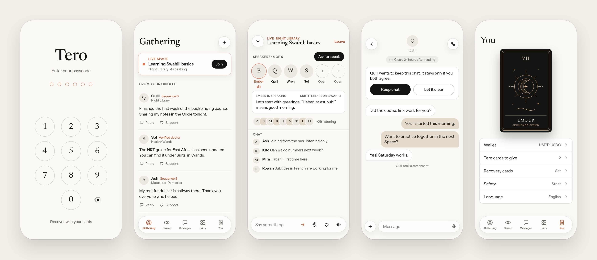

<div align="center">


<h1>Tero</h1>

<p><strong>Queer knowledge, resources, community, and support.</strong></p>

<p>A place to find help, share what you know, and build trusted connections.</p>

<p>
  <a href="https://tero.pherus.org">Website</a> ·
  <a href="docs/status-audit-2026-10-20.md">Project overview</a> ·
  <a href="docs/roadmap.md">Roadmap</a> ·
  <a href="docs/threat-model.md">Privacy &amp; security</a>
</p>

</div>

<p align="center">
  
</p>

<p align="center">
  <sub>Early design preview, not current app screenshots. Spaces, wallets, and some controls shown remain planned; labels and layouts have since evolved.</sub>
</p>

---

## A community built around helping

Tero is an invite only platform by [Pherus](https://pherus.org) where queer people
can find useful resources, help one another, and build trusted connections. It is
being developed with particular attention to people for whom disclosure can be
dangerous. Its purpose is practical support across care, work, safety, and health.

| Find support                                                         | Connect privately                                                           | Plan your next steps                                           |
| -------------------------------------------------------------------- | --------------------------------------------------------------------------- | -------------------------------------------------------------- |
| Explore member shared places, jobs, mutual aid, stories, and skills. | Find people, accept a connection, and continue through encrypted text chat. | Keep personal journeys and checklists in an encrypted planner. |

## Current state

As of **20 October 2026**, Tero is an early development product with working
Android and iPhone test apps, a public website, resource features, and native
encrypted text chat. It is past the mockup stage. It is not yet an audited service
ready for broad membership or use in high risk situations.

The owner confirmed real chat between the phones on 14 October and both updated
apps working on 16 October. The installed test apps use a separate hosted service
at `https://tero.pherus.org/_test`. Those confirmations do not establish every
notification, receipt, expiry, or background behavior.

Read the [full project audit](docs/status-audit-2026-10-20.md) for the feature
inventory, purpose of each service, evidence, security findings, and impact
assessment. The [roadmap](docs/roadmap.md) explains what remains and estimated effort.

## What exists

| Feature                    | Purpose and current boundary                                                                                                                                                    |
| -------------------------- | ------------------------------------------------------------------------------------------------------------------------------------------------------------------------------- |
| Identity and recovery      | Device held keys and 12 recovery words, without requiring email or phone registration. Phrase recovery exists; social recovery remains planned.                                 |
| Lock and decoy view        | Encrypted vault, passcode retry delays, manual lock, a basic decoy view, and optional phone biometrics. The decoy does not yet send a duress alert.                             |
| Tero invitations           | Single use cards, claim and confirmation flow, inviter approval, and founder controlled council invitations. Full referral governance remains planned.                          |
| Help                       | Member submitted directories, mutual aid, jobs, stories, skills, and learning resources. Submissions and replies are readable by the backend.                                   |
| Journeys                   | Encrypted personal plans and checklists. This is a planner, not a booking, medical, or legal service.                                                                           |
| Gathering                  | A feed of actual Help posts with filters and links to their boards. General posts, events, polls, and Circle publishing remain planned.                                         |
| Discovery and contacts     | Encrypted signed profiles, permanent handles, editable names, search on the device, requests, and accepted contacts.                                                            |
| Private text chat          | Native OpenMLS encryption, encrypted saved state, retries, receipt and expiry logic, unread indicators, and short lived activity status. Lifecycle evidence remains incomplete. |
| Notifications              | Expo, FCM, and APNs integration. Android alert receipt was confirmed. Actual iPhone delivery, tap routing, and sound still need focused evidence.                               |
| Website and administration | Public guides and languages; a limited founder/council console for counts and invitations. Voting and full moderation remain planned.                                           |

The five tabs are Gathering, Circles, Messages, Help, and You. Circles currently
provides member discovery and contacts; group communities and live Spaces are not
implemented. Help uses plain resource names. Tarot identities remain part of
membership, rather than organising resources into suits.

English, Kiswahili, Chinese, and French dictionaries exist. Native language and
specialist content review remain necessary. Two public guides have text; four
listed guides are still being written.

## Privacy and security today

Private messages use native OpenMLS encryption; personal journeys and directory
profiles also have client encryption. **Tero does not encrypt every kind of data
from the service operator.** Help content, membership records, connection pairs,
push registrations, and transport metadata have different exposure boundaries.
Display names are included in alert titles by the owner's choice; message bodies
are not.

There is no independent security audit recorded here. Duress delivery, social
recovery, complete blocking/reporting, governance transitions, and independent
network membership remain unfinished. Expiry does not guarantee forensic erasure
or scheduled deletion while a phone is stopped. Read the
[current threat model](docs/threat-model.md) before relying on a protection.

## Tero and Sefirah

Tero is the application. **Sefirah** is the intended reusable network underneath it:
private routes, encrypted distribution, optional community nodes, and nearby
exchange, with Cloudflare as fallback. Native Tor foundations and encrypted
delivery exist, but current admission and coordination still depend on the central
service. Independent membership, replication, Bluetooth/LAN discovery, and
operation by other organisations remain future work.

## Development

<details>
<summary><strong>Explore the codebase and development setup</strong></summary>

Bun workspaces contain Expo/React Native and TypeScript, Cloudflare Workers with
SQLite Durable Objects, and Rust native MLS and Tor modules. The backend uses
direct routing and SQL. Hono, Drizzle, D1, and R2 are not current application services.

```bash
bun install --frozen-lockfile
bun run typecheck
bun run test
bun run check
```

Start with [AGENTS.md](AGENTS.md), [the handoff](docs/continuation.md), and
[development instructions](docs/development.md) before running shared device
services. Preserve existing accounts and storage. iPhone testing uses TestFlight;
Expo Go cannot validate the custom native chat and Tor modules.

| Path                | Responsibility                                                  |
| ------------------- | --------------------------------------------------------------- |
| `apps/app`          | Phone app, public website, administration, native modules       |
| `apps/edge`         | Authentication, invitations, boards, discovery, mailboxes, push |
| `packages/crypto`   | Keys, signing, vaults, encrypted object helpers                 |
| `packages/protocol` | Shared API contracts and validation                             |
| `packages/i18n`     | Language dictionaries                                           |
| `packages/ui`       | Shared visual tokens                                            |
| `docs`              | Vision, decisions, evidence, roadmap and specifications         |

</details>

## Direction and participation

Next come focused phone delivery evidence, reliability, reporting and blocking,
recovery and governance, and independent review. The [roadmap](docs/roadmap.md)
separates a bounded hosted beta from the longer Sefirah programme. Its estimates
are planning ranges, not release dates.

Tero could reduce the work and isolation involved in finding support. Population
impact has not yet been measured. Useful contributions include development,
translation, resource curation, moderation, and qualified professional review.
Contribution intake and professional verification are not established services
yet. See the [contributor agreement](CLA.md).

The name and tarot inspiration come from the Tarot Club in _Lord of the Mysteries_.

---

<p align="center">
  A <a href="https://pherus.org">Pherus</a> project ·
  Open source under <a href="LICENSE">AGPL-3.0</a><br>
  <sub>Built around care, dignity, and community.</sub>
</p>
