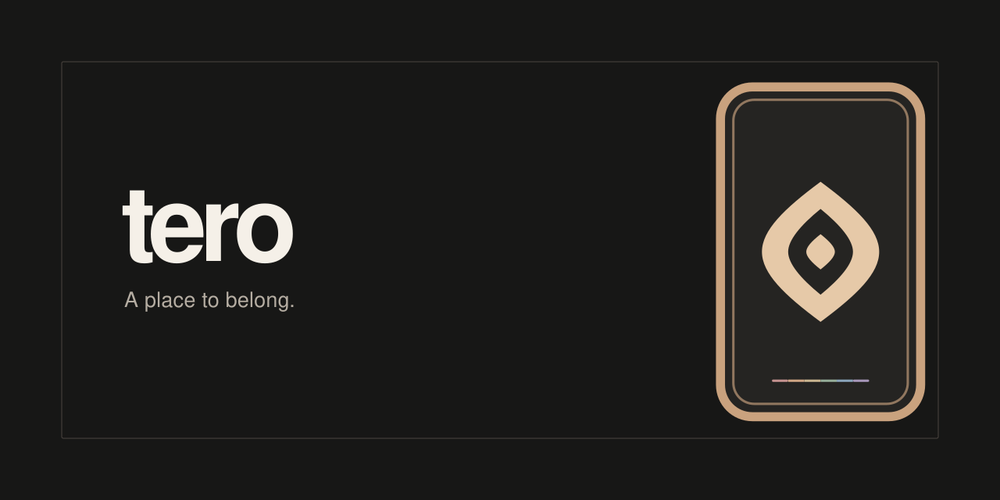

<div align="center">


# Tero

**A place to belong.**

An open-source space for LGBTQIA+ people to find trusted connections, share
useful knowledge and help one another, particularly where visibility carries
real risks.

[Vision](docs/vision.md) · [Roadmap](docs/roadmap.md) · [Safety](docs/threat-model.md) · [Contribute](#help-build-tero)



</div>

## Why

Finding a trusted doctor, a safe place to stay, practical advice or simply
someone who understands should not require taking unnecessary risks.

Tero is being built around **care, consent and trusted introductions**. It is
about people being useful to one another, not building another public feed.

## The experience

**Gathering** for discovery. **Circles** for trusted people. **Messages** for
conversation. **Help** for practical resources. **You** for personal space.

The established tarot-inspired cards and app navigation remain. We are
improving their quality without redesigning what already works.

<p align="center"></p>

<p align="center"><sub>Early concept artwork, not a current app screenshot.</sub></p>

## Where we are

**Tero is under active development and is not ready for use in high-risk situations.**
The legacy test app has demonstrated invitations, directories, device vaults
and native encrypted one-to-one messaging. The Tauri replacement and peer-first
network are still being completed and tested.

Not all information is end-to-end encrypted. Some support submissions and
service metadata remain accessible to the server. Please do not share
information that could endanger you or someone else. Read the
[current audit](docs/status-audit-2026-10-20.md).

### Expo → Tauri

We are moving to **one Tauri v2 app** with a shared TypeScript interface and
Rust for native identity, storage and cryptography. The Expo test app remains
available for migration checks until parity is proven.

## Help build Tero

We welcome LGBTQIA+ contributors and allies across design, engineering,
translation, security, accessibility and community resource review.

We also welcome funding and partnerships for independent security review,
localisation, safer mobile releases and community stewardship. We have not yet
measured impact or launched a public service.

**Contact:** [pherus@pherus.org](mailto:pherus@pherus.org)

### For developers

The repository uses Bun, Turborepo, TanStack, PassUI, Rust and Tauri v2.
The deployed backend remains a single Cloudflare Worker. Start with the
[migration notes](docs/development/migration.md),
[engineering conventions](docs/development/conventions.md) and
[current handoff](docs/continuation.md).

```bash
bun install --frozen-lockfile
bun run build:web
bun run --cwd apps/tero typecheck
bun run --cwd apps/tero test
```

<div align="center">

Built by [Pherus](https://pherus.org) · [AGPL-3.0](LICENSE)

</div>
